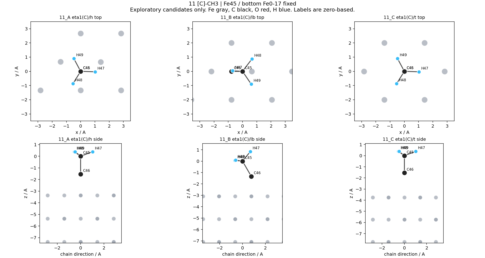
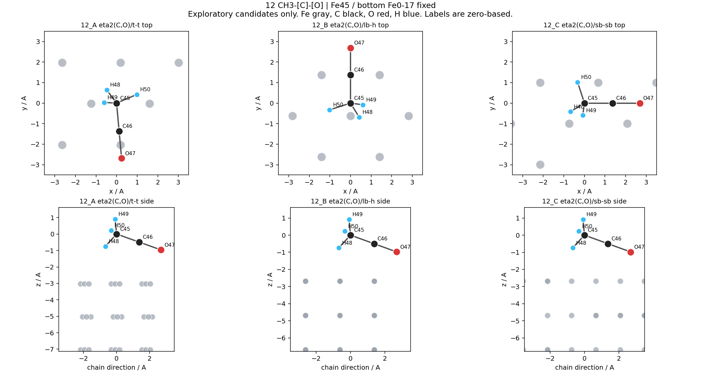
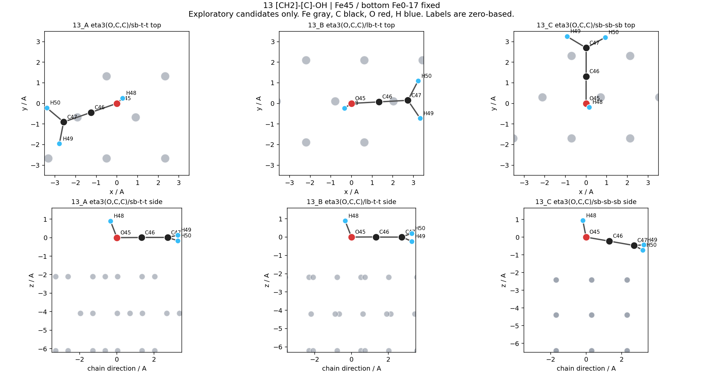
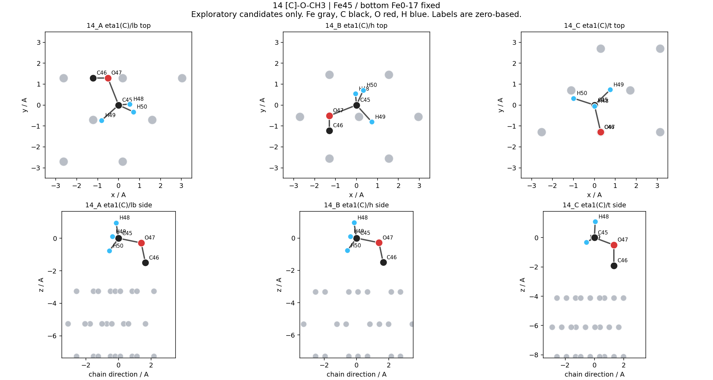
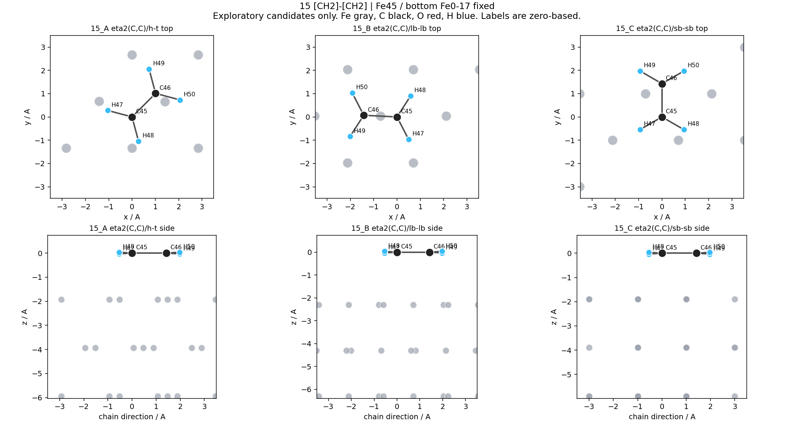

# Fe(110) 第 11–15 项：每种三套初始吸附构型

已构建 15 个 POSCAR、五张三构型俯视/侧视图和数值几何表。全部通过初始几何检查；零次模型调用、零次计算提交。

这些是待弛豫候选。A/B/C 表示本次准备顺序，不代表能量排名；没有把任何候选称为已证明的最稳态。

## 物种与候选

| 项目 | 精确连接 | A | B | C |
|---|---|---|---|---|
| 11 C2H3 | `[C]-CH3` | [11_A：C_hollow_upright](11_A/POSCAR) | [11_B：C_long_bridge_tilted](11_B/POSCAR) | [11_C：CARE_C_top](11_C/POSCAR) |
| 12 C2H3O | `CH3-[C]-[O]` | [12_A：CARE_eta2_C_O](12_A/POSCAR) | [12_B：acyl_C_long_bridge](12_B/POSCAR) | [12_C：acyl_C_short_bridge](12_C/POSCAR) |
| 13 C2H3O | `[CH2]-[C]-OH` | [13_A：CARE_C_C_OH_orientation_1](13_A/POSCAR) | [13_B：CARE_C_C_OH_orientation_2](13_B/POSCAR) | [13_C：radical_C_short_bridge](13_C/POSCAR) |
| 14 C2H3O | `[C]-O-CH3` | [14_A：terminal_C_long_bridge](14_A/POSCAR) | [14_B：terminal_C_hollow](14_B/POSCAR) | [14_C：CARE_terminal_C_top](14_C/POSCAR) |
| 15 C2H4 | `[CH2]-[CH2]` | [15_A：multi_Fe_C_C_hollow_guided](15_A/POSCAR) | [15_B：CARE_eta2_C_C_long_bridge](15_B/POSCAR) | [15_C：C_C_short_bridge_orientation](15_C/POSCAR) |

11：C 端三 Fe 空位、双 Fe 长桥及单 Fe 顶位。12：保留 CH3 的 C/O 双中心三种排列。13：保持 OH 上的 H，使用三种链/OH 排列。14：保持 C–O–C，改变无 H 端 C 的配位。15：三 Fe 多中心假说、既有双 C 单 Fe 近邻姿态和短桥方向姿态。

## 文献依据与适用边界

先做白名单有界检索：未得到可用精确结构记录。空记录校验通过不等于生产检索通过；未执行 BM25/语义排序。检索范围和访问限制保存在 retrieval/。

- [Vibrational spectra of acetylene and ethylene adsorbed on Fe(110)](https://www.sciencedirect.com/science/article/pii/0039602882901510)，DOI `10.1016/0039-6028(82)90151-0`：Molecular ethylene on Fe(110) at 120 K; EELS favors triangular mu3 adsorption and a trans-twisted molecular conformation. Abstract accessible through indexed publisher content; full-text open failed. No numerical twist angle or coordinates recovered. 15_A has three Fe contacts but does not reconstruct the trans-twisted geometry.
- [Successive Dissociation of CO, CH4, C2H6, and CH3CHO on Fe(110): Retrosynthetic Understanding of FTS Mechanism](https://pubs.acs.org/doi/abs/10.1021/acs.jpcc.8b10310)，DOI `10.1021/acs.jpcc.8b10310`：Fe(110) calculations include acetyl CH3CO and ethylene C2H4. Publisher abstract and SI description indexed; direct full text/SI access failed. Different cell/coverage; no transferable coordinates obtained.
- [Mechanistic insight into CO activation, methanation and C-C bond formation from coverage dependent CO hydrogenation on Fe(110)](https://www.sciencedirect.com/science/article/pii/S0039602819302651)，DOI `10.1016/j.susc.2019.121456`：The primary Fe(110) mechanism includes CH3CO and CH3C. High-coverage model; indexed publisher abstract only, direct open HTTP 403; no local site ranking or geometry copied.
- [Structural trends in the dehydrogenation selectivity of palladium alloys](https://pubs.rsc.org/en/content/articlehtml/2020/sc/d0sc00875c)，DOI `10.1039/D0SC00875C`：Contains a pure bcc Fe(110) comparison including ethylidyne. Alloy geometries cannot be transferred to bare Fe(110); the indexed Fe(110) supplement does not establish our hollow/bridge/top ordering.

未获取每种三套最低能坐标。13、14 未找到本次裸 Fe(110) 精确图的可用结构证据；按用户本轮授权使用既有 CARE 局部模板及合理锚定假说。11 的空位/桥位比较同样属于构造假说。15_A 只借鉴多 Fe 配位线索，未复原文献 trans-twisted 构型，也未指定没有来源的扭转角。

CARE 姿态和原始排序量属于模型预测来源；构造姿态不继承母姿态能量。外部及预测能量均未进入本地吸附能、注册表或 Excel。

## 初始几何核验

同一清洁 Fe45 晶胞及 Fe 坐标完全保留，底部 Fe1–18 固定，其余原子可动。独立 V3000 图核对和周期距离检查确认三种 C2H3O 未互换、OH 上的 H 未迁移。表中 Fe 原子编号从 1 开始，距离单位 Å。

| 构型 | C–O 键 | 最近 C–Fe（Fe编号） | 最近 O–Fe（Fe编号） | 最小非键接触 | 判定 |
|---|---|---|---|---|---|
| 11_A | — | 3.611(Fe42)/2.250(Fe42) | — | 1.770 | 初始几何通过 |
| 11_B | — | 3.153(Fe45)/2.250(Fe44) | — | 1.770 | 初始几何通过 |
| 11_C | — | 3.743(Fe42)/2.200(Fe42) | — | 1.770 | 初始几何通过 |
| 12_A | 1.405 | 3.269(Fe44)/2.621(Fe42) | 2.167(Fe42) | 1.770 | 初始几何通过 |
| 12_B | 1.405 | 2.754(Fe42)/2.600(Fe44) | 1.832(Fe38) | 1.770 | 初始几何通过 |
| 12_C | 1.405 | 2.936(Fe44)/2.500(Fe42) | 2.065(Fe42) | 1.770 | 初始几何通过 |
| 13_A | 1.325 | 2.215(Fe42)/2.215(Fe42) | 2.380(Fe40) | 1.871 | 初始几何通过 |
| 13_B | 1.325 | 2.310(Fe42)/2.310(Fe42) | 2.338(Fe41) | 1.871 | 初始几何通过 |
| 13_C | 1.325 | 2.500(Fe42)/2.096(Fe44) | 2.524(Fe42) | 1.871 | 初始几何通过 |
| 14_A | 1.420/1.411 | 3.510(Fe45)/2.250(Fe44) | 3.056(Fe45) | 1.771 | 初始几何通过 |
| 14_B | 1.420/1.411 | 3.367(Fe45)/2.250(Fe42) | 3.348(Fe44) | 1.771 | 初始几何通过 |
| 14_C | 1.420/1.411 | 4.319(Fe44)/2.200(Fe42) | 3.611(Fe42) | 1.771 | 初始几何通过 |
| 15_A | — | 2.350(Fe42)/2.007(Fe45) | — | 1.875 | 初始几何通过 |
| 15_B | — | 2.408(Fe42)/2.408(Fe42) | — | 1.875 | 初始几何通过 |
| 15_C | — | 2.250(Fe42)/2.061(Fe44) | — | 1.875 | 初始几何通过 |

全部 15 项初始几何通过，当前规则软警告 0 项。同物种构型的最小对称去重 RMSD 为 0.440 Å，大于既有 0.20 Å 阈值；乙烯额外计入两个 C 的互换及相同 H 的排列。去除统一高度位移，未用单纯升降补数量。

22 项相关测试、语法、导入和定向 Ruff 检查的实际输出见 ../validation_commands.json。独立核验结果见 ../initial_geometry_verification.json。原始预测姿态及未选用原因保存在 originals/ 和 candidate_review.json。

## 结构图

### 第 11 项



### 第 12 项



### 第 13 项



### 第 14 项



### 第 15 项



## 复现

从 work 根目录运行，输出目录必须是新目录：

```powershell
python -m scripts.adsorption.build_fe110_care_batch --network C:/Users/86177/Desktop/app/CARE_Fe110_FT_C1_C6/evaluated_networks/ft_C2O1_Fe110_eval.pkl.json.gz --slab calculations/true_fe110_clean_20260629/results/job_9557161/CONTCAR --request configs/adsmind_lite/fe110_c2_11_15_exploratory_20261020.json --output calculations/fe110_c2_adsorption_11_15_20261020/reproduced_candidates
```

原网络和清洁 slab 的 SHA256 由请求文件固定，缺失时必须取回同一来源，不能换用同分子式结构。未验证弛豫稳定性、电子/力收敛、吸附能及全局最低能。下一步：审阅这些构型，再确定单独的预弛豫范围。
