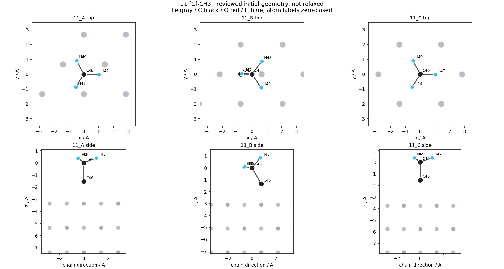
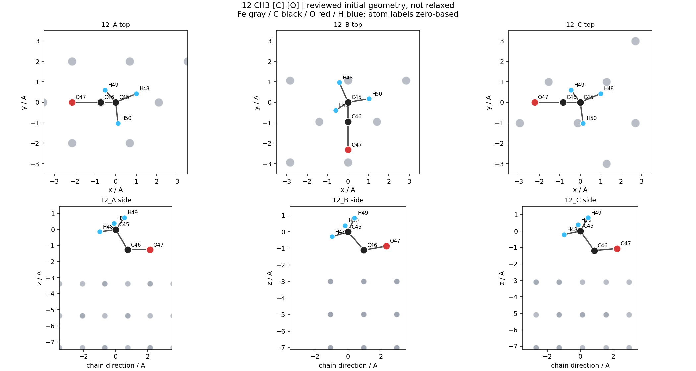
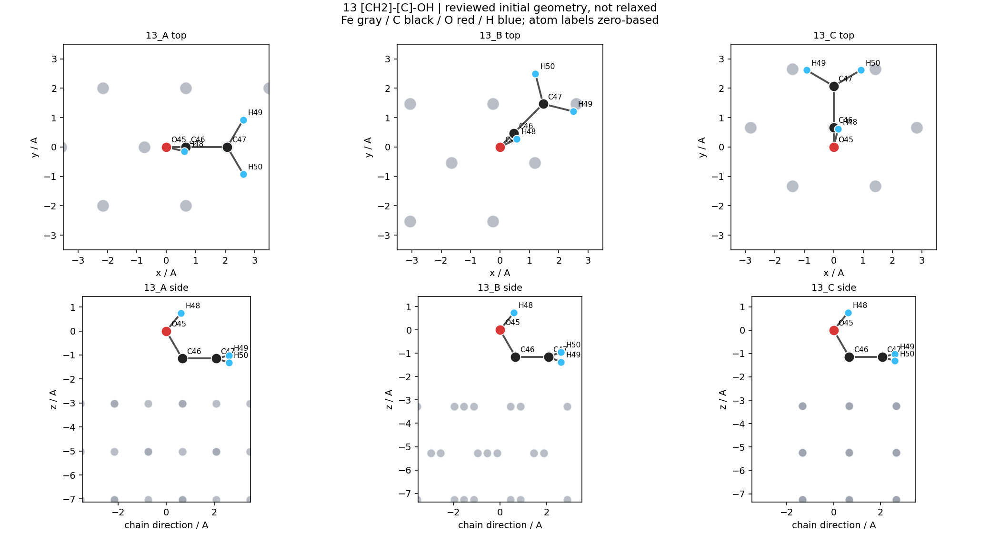
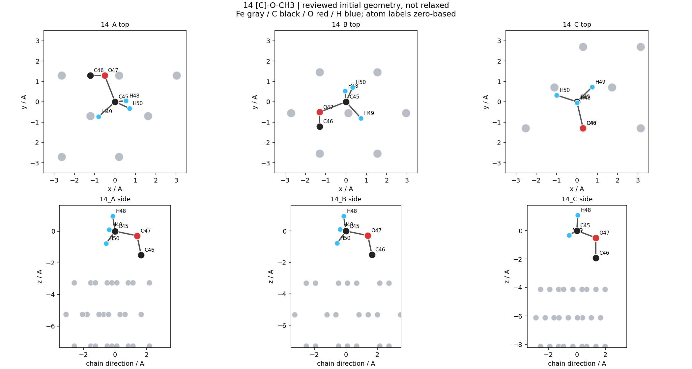
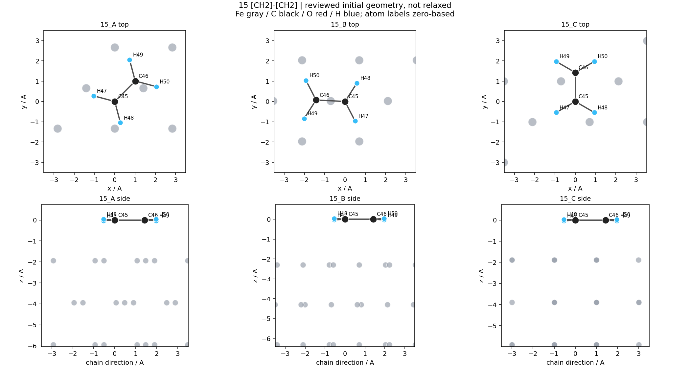

# 15 个初始吸附结构的化学几何复核（v5）

结论：修正了第 12、13 项的六个线性 C–C–O 模板，其余九个 POSCAR 保持原始字节。修正后 15/15 通过本次初始几何合理性检查。

本次确认的是可用于后续弛豫的初始几何，不是稳定态、最终吸附位点或能量排序。

## 修正内容

- 原第 12 项三套 C–C–O 约 180.00°，第 13 项三套约 179.72°。上一轮没有审核这些键角，旧版的几何通过不能覆盖这项缺口。
- 将整段 O 或 OH 支路围绕相连碳旋转，构造 120° 弯曲骨架，再按三种不同的表面配位重新放置。所有原有共价键长和 H 的归属保持不变。
- 120° 是明确的初始构造假设，并非本体系已验证的平衡键角。没有编造文献数值，也没有改变锁定的 DFT 方法。
- 11/14 的空位、桥位、顶位作为不同起始配位保留；低配位起点可能在弛豫中迁移。15_B 按实际近邻为双 C 指向同一 Fe 的 π 类起点，不能仅凭 lb-lb 投影称为双金属 di-σ。

## 逐构型检查

距离单位 Å；Fe 编号从 1 开始。C–Fe 按两个 C 在 POSCAR 中的顺序列出，含可远离表面的甲基 C。
重原子键角列为 C–C–O / O–C–C 或 C–O–C；不适用时写 —。

| 构型 | 修正 | 重原子键角 | C–O | 最近 C–Fe（Fe编号） | 最近 O–Fe（Fe编号） | 最小非键接触 | 初始几何 |
|---|---|---|---|---|---|---|---|
| [11_A](11_A/POSCAR) | 保留 | — | — | 3.611(Fe42)/2.250(Fe42) | — | 1.770 | 通过 |
| [11_B](11_B/POSCAR) | 保留 | — | — | 3.153(Fe45)/2.250(Fe44) | — | 1.770 | 通过 |
| [11_C](11_C/POSCAR) | 保留 | — | — | 3.743(Fe42)/2.200(Fe42) | — | 1.770 | 通过 |
| [12_A](12_A/POSCAR) | 是 | 120.00° | 1.405 | 3.444(Fe42)/2.100(Fe42) | 2.527(Fe42) | 1.770 | 通过 |
| [12_B](12_B/POSCAR) | 是 | 120.00° | 1.405 | 3.179(Fe38)/2.350(Fe44) | 2.209(Fe42) | 1.770 | 通过 |
| [12_C](12_C/POSCAR) | 是 | 120.00° | 1.405 | 3.245(Fe42)/2.250(Fe42) | 2.350(Fe44) | 1.770 | 通过 |
| [13_A](13_A/POSCAR) | 是 | 120.00° | 1.325 | 2.350(Fe44)/1.877(Fe45) | 3.117(Fe44) | 1.871 | 通过 |
| [13_B](13_B/POSCAR) | 是 | 120.00° | 1.325 | 2.450(Fe42)/2.401(Fe45) | 3.515(Fe42) | 1.871 | 通过 |
| [13_C](13_C/POSCAR) | 是 | 120.00° | 1.325 | 2.100(Fe42)/2.530(Fe42) | 3.314(Fe42) | 1.871 | 通过 |
| [14_A](14_A/POSCAR) | 保留 | 110.71° | 1.420/1.411 | 3.510(Fe45)/2.250(Fe44) | 3.056(Fe45) | 1.771 | 通过 |
| [14_B](14_B/POSCAR) | 保留 | 110.71° | 1.420/1.411 | 3.367(Fe45)/2.250(Fe42) | 3.348(Fe44) | 1.771 | 通过 |
| [14_C](14_C/POSCAR) | 保留 | 110.71° | 1.420/1.411 | 4.319(Fe44)/2.200(Fe42) | 3.611(Fe42) | 1.771 | 通过 |
| [15_A](15_A/POSCAR) | 保留 | — | — | 2.350(Fe42)/2.007(Fe45) | — | 1.875 | 通过 |
| [15_B](15_B/POSCAR) | 保留 | — | — | 2.408(Fe42)/2.408(Fe42) | — | 1.875 | 通过 |
| [15_C](15_C/POSCAR) | 保留 | — | — | 2.250(Fe42)/2.061(Fe44) | — | 1.875 | 通过 |

## 验证与边界

- 15 个最终 POSCAR 均由独立读取器回读，与原始 V3000 分子图和氢数匹配；六个修正构型全部原有键长变化小于 1e-10 Å；九个保留构型哈希完全相同。
- Fe45 晶胞、全部 Fe 坐标及固定层约束不变；吸附物全部可动；未出现原子交换、断键、H 转移或埋入表面。
- 最短 H–Fe 为 1.906 Å，最小非键接触 1.770 Å。相邻周期分子最短接触 4.213 Å；z 方向剩余空隙最小 9.775 Å，并检查了相对表面的周期镜像。此处是碰撞筛查，不是重新声称真空收敛。
- 同物种最小对称 RMSD 为 0.808 Å，大于既有 0.20 Å 阈值；乙烯包含等价 C/H 互换，并去除统一高度位移。
- 33 项相关测试、语法、导入及定向 Ruff 通过；实际命令和输出见 ../geometry_review_validation.json。独立回读见 independent_readback.json。
- 键长、键角和接触窗口属于本次保守构造筛查假设，不是跨物种通用科学验收标准。未运行模型预测、GPU、VASP、力计算、振动或能量比较。
- 最稳态、电子/力收敛、真实配位及是否迁移或解离，仍需后续弛豫及相应科学验证。

## 结构图

### 第 11 项



### 第 12 项



### 第 13 项



### 第 14 项



### 第 15 项



## 复现

```powershell
python -m archive.fe110_c2_11_15_20261020.refine_and_audit --request configs/adsmind_lite/fe110_c2_11_15_geometry_review_20261020.json --output calculations/fe110_c2_adsorption_11_15_20261020/reviewed_reproduction
```

复现使用已哈希固定的 v3 来源。输出目录必须不存在；v3/v4/v5 均不覆盖。此前白名单检索和文献限制仍见 ../retrieval/。下一步：对这 15 套初始构型进行另行确定范围的预弛豫验证。
