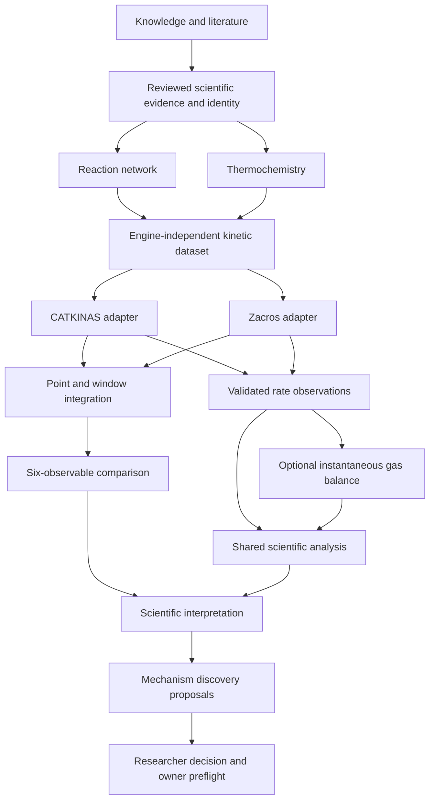

# V3.1 implemented scientific flow

This diagram shows data flow. Import arrows and source owners are recorded separately.

Workflow orchestration selects domain operations. Execution governance checks authority for operations with side effects. Artifact Lifecycle Phase 1 owns test artifact classification, manifests, sealing and cleanup proposals. Existing evidence registry transactions and raw execution receipts keep their respective owners. A discovery handoff carries a reviewed proposal to a DFT, NEB/DIMER or model workflow; a new computation and its returned evidence would require separate approval.
