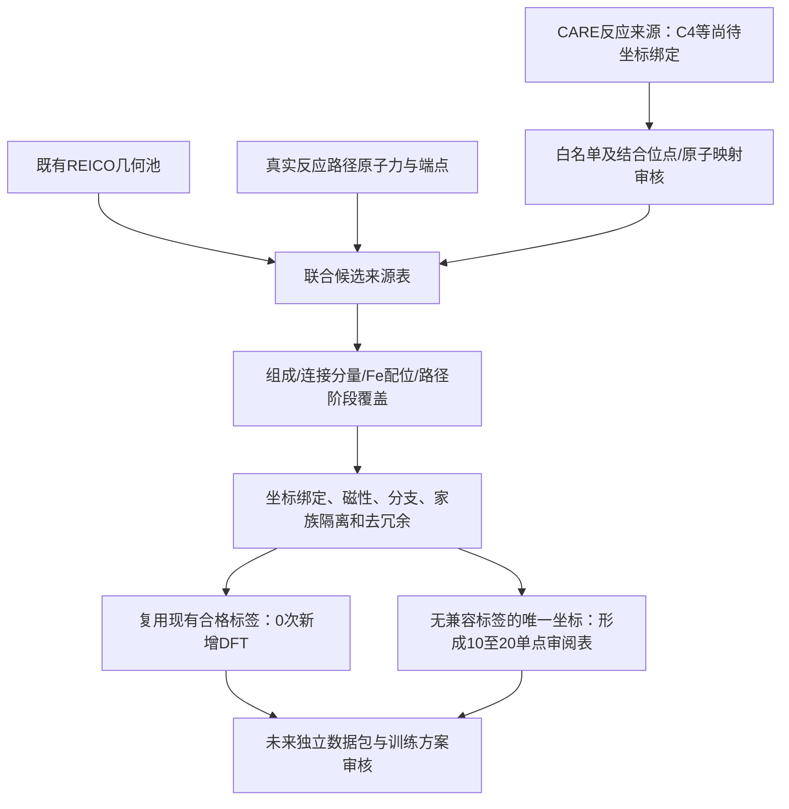

# C₂–C₄反应路径与结构优化缺口：REICO和反应来源联合只读盘点

日期：2026-11-14。状态：来源盘点和后续方案，**不构成数据准入、模型晋升或计算执行授权**。

结论：采用“REICO补几何/配位覆盖，真实反应路径补成键、断键及迁移过程”的组合路线。现有536的新增24帧补上了C₃训练侧的低力区域，但没有消除已有联合几何环境缺口，也没有补成独立C₃近稳定验收集。C₄是主线缺口；C₅/C₆只保留少量代表性反应来源。

本轮没有生成新REICO结构、模型推理、训练、ML优化、DFT单点、VASP优化、NEB或DIMER；没有改动512/536包、78/53/16分区、权重、注册库、执行后端或科学协议。`tasks/current_task.md`仍指向另一项六作业VASP对照任务，本轮未覆盖该指针。

## 1. 实际核查范围与输出

- 只读SQLite快照：648个计算记录、546个作业记录、12,955个文件记录、1,645个结果记录；没有初始化或回写注册库。
- 本地实际读取17,659个VASP5结构头，范围为本项目`calculations/`、已定位CARE项目的`data/processed/`及注册库中可用的本地结构指针。按元素/原子数读取，未用文件名、哈希名称或注释推断化学组成。
- 数据服务器按530个已登记VASP目录及注册文件指针读取：1,033个有效结构头、2个空CONTCAR。285个其他GPU后端文件指针因不属于该DFT根目录而跳过，没有跨服务器误读。有效本地/DFT结构头中未发现C₄–C₆坐标。**这不证明未登记目录或其他GPU服务器上绝对不存在C₄–C₆结构。**
- 复用512覆盖缓存，对536训练集更新几何联合覆盖；仅对已准入的新增24个结构计算几何接触图，未计算新SOAP描述符或运行模型。
- 核查既有能量/力旁路目录、近稳定独立来源提案、反应标签、CARE反应表；区分真实坐标、同坐标DFT标签、标量能量和只有反应式的来源。

规范输出位于：
`C:/Users/86177/Desktop/work/calculations/fe110_reico_pilot300_20261022/c2_c4_gap_inventory_20261114_v1/`

| 输出 | 内容 |
|---|---|
| [gap_matrix.csv](C:/Users/86177/Desktop/work/calculations/fe110_reico_pilot300_20261022/c2_c4_gap_inventory_20261114_v1/gap_matrix.csv) | 13项几何、反应、优化、验收和实现缺口及优先级 |
| [candidate_inventory_v2.csv](C:/Users/86177/Desktop/work/calculations/fe110_reico_pilot300_20261022/c2_c4_gap_inventory_20261114_v1/candidate_inventory_v2.csv) | 39条结构/标签来源引用、路径/SHA、标签状态和阻塞项；不是39个独立结构或39次DFT |
| [reaction_source_proposals.csv](C:/Users/86177/Desktop/work/calculations/fe110_reico_pilot300_20261022/c2_c4_gap_inventory_20261114_v1/reaction_source_proposals.csv) | 14个真实反应记录ID；没有虚构坐标或结构ID |
| [compatible_backup_reuse.csv](C:/Users/86177/Desktop/work/calculations/fe110_reico_pilot300_20261022/c2_c4_gap_inventory_20261114_v1/compatible_backup_reuse.csv) | 142个536包外、训练侧既有兼容标签的来源与复用审核范围 |
| [existing_path_labels_v2.csv](C:/Users/86177/Desktop/work/calculations/fe110_reico_pilot300_20261022/c2_c4_gap_inventory_20261114_v1/existing_path_labels_v2.csv) | 17个同坐标路径标签，含6个受保护标签 |
| [reico536_coverage_v3.json](C:/Users/86177/Desktop/work/calculations/fe110_reico_pilot300_20261022/c2_c4_gap_inventory_20261114_v1/reico536_coverage_v3.json) | 全部178类联合几何缺口、536训练力区间、来源与三档接触阈值 |
| [final_verification.json](C:/Users/86177/Desktop/work/calculations/fe110_reico_pilot300_20261022/c2_c4_gap_inventory_20261114_v1/final_verification.json) | 12项只读/来源/分区/权重守卫，结果PASS |

同名JSON提供完整图、磁性、来源偏移量和兼容性字段。原始字节哈希由项目Python实现计算，未经PowerShell/JavaScript重新序列化生成科学绑定。中间coverage v1/v2和首次远程超时记录保留，但不作为最终证据；最终采用coverage v3、candidate inventory v2及成功的remote v2。

## 2. REICO实际覆盖与536训练侧缺口

本项目的REICO是已有`REICO-inspired`小范围几何采样与覆盖流程，不等同于完整官方REICO方法。随机起点保留全部45个Fe的初始坐标和晶胞；约束只固定底18个Fe。后续既有LBFGS短轨迹中，上27个Fe与吸附质可动。因此，“起点没有随机扰动Fe”与“全过程固定全部表面Fe”是两件事。

下表低力定义为**排除固定原子后，包含可动Fe与全部吸附质的最大DFT力≤0.05 eV/Å**，不是ML预测力，也不是最终0.02 eV/Å验收标准。

| 组成 | 536内训练帧 | 低力帧 | 低力来源组数 | 池中仍缺联合几何类型 | 三档阈值下稳健缺失组 |
|---|---:|---:|---:|---:|---:|
| C₂HO | 122 | 9 | 4 | 20 | 4 |
| C₂H₂O | 190 | 17 | 6 | 25 | 9 |
| C₂H₃ | 51 | 4 | 1 | 39 | 11 |
| C₃H₂O | 150 | 24 | 1 | 94 | 41 |
| 合计（另有23帧其他回放） | 513 | 54 | 不跨组成相加作独立结构数 | 178 | 65 |

比较池为既有1,597个训练侧几何帧。178类覆盖460个池帧，不等于178个新DFT任务。458帧按原始结构文件SHA没有匹配既有旁路目录标签；另2帧有既有标签，但分别存在磁性或SCF/对应阻塞。**未匹配不等于已经证明需要重算**：本轮没有完成所有不同序列化结构的坐标等价、表面对称及近重复检索。

新增24帧来自`family_0099 / job9924387`，低力联合类型只有2种。与原512比较，新增帧没有减少这178类几何缺口，说明它们主要补充优化阶段分布。不能由此推断新536模型的力误差、反应能力或VASP加速效果。

SOAP只引用已经绑定到**512参考集**的历史评分，保留原阈值；本轮没有536版新SOAP、committee不确定性或新536批量力预测。距离阈值稳健性使用1.20/1.25/1.30三档几何接触尺度；这些接触图不能证明电子成键、键级或稳定极小值。

## 3. 可复用标签与现有真实路径

既有旁路目录有861个唯一物理标签；486个具备原始能量、力和局域磁性证据。427个属于训练侧后续复用审核候选，其中285个已在536中，另142个包外备选为**C₂H₃ 71个、C₃H₂O 71个**。这142个在默认联合图尺度下没有补到上述178类缺口，但仍可供优化阶段/相对能量监督的复用审核。不能把它们当作142个新反应环境或独立验收来源。

“具备证据”不等于已准入能量训练：原始TOTEN不能直接当作AQCat25绝对能量目标；原磁性等级、能量参考和冻结分区继续保留。

| 已有来源 | 已确认内容 | 复用前阻塞/限制 | 新DFT处理 |
|---|---|---|---|
| C+H→CH静态路径标签 | 11个同坐标E/F，SCF与现行分支证据通过；5个训练诊断、6个受保护TS验证 | 11个均无逐原子磁矩表；6个验证标签禁止进训练 | 先审核既有磁性适用范围，不能自动变成11次重算 |
| CH+CO→CHCO，`job9994246_image01–06_opt207` | 6个同坐标原始原子E/F，另有含端点的8个标量剖面点 | 6个均缺逐原子磁矩；不是已验收势垒/TS；不自动等同CO插入 | 优先复用诊断、提取既有轨迹；不直接重算6个 |
| CO解离、CH+H→CH₂、C+H→CH、C₂HO+H的O–H形成 | 4套已有已验收电子能垒、12个原始标量能量锚点 | 标量能量不是自动可用的同坐标力标签；保留O–H分支的部分Hessian适用范围 | 原始参考无需重复计算；先提取既有力记录 |
| INT06/MID/IS-A表面H迁移 | 已登记NEB/DIMER与诊断来源指针 | 部分工作流状态通过不等于已经有已验收能垒；尚未转换为完整逐帧训练准入清单 | 先读既有结果，不据指针直接要求新DFT |

NEB训练监督必须使用原始`TOTAL-FORCE`原子力，不能使用弹簧力/投影NEB力。对称映射过的端点能量不能授权直接复用未经相同变换的力矢量。路径标签不要求父优化一定已达到极小值，但要求每帧电子收敛、坐标—力—能量对应、磁性和适用分支通过其所属审核。

## 4. 真实REICO几何候选：尚非单点准入表

本轮筛出12个几何来源供下一次联合审核。它们来自训练侧家族，不能挪作新独立验收。现存ML最大力只是旧采样轨迹的记录，不是新536预测，也不能作为已知DFT残余力。

| 实际结构ID | 组成 | 覆盖理由/几何限制 |
|---|---|---|
| `family_0021_step005` | C₂HO | 三档阈值稳健的缺失类型；同家族step004有失败标签，不能借用其力 |
| `family_0013_step004` | C₂HO | 稳健配位/接触类型缺口；有分离吸附质分量 |
| `family_0054_step005`、`family_0050_step006` | C₂H₂O | 稳健联合缺口；保留C₂骨架，同时有其他吸附质分量 |
| `family_0039_step016` | C₂H₃ | 稳健联合缺口；存在单独吸附质分量，不称完整近稳定C₂H₃ |
| `family_0003_step016` | C₂H₃ | 碳分裂接触环境；不是完整C₂骨架 |
| `family_0094_step016`、`family_0100_step003` | C₃H₂O | C₂+C₁类分裂环境；不能补完整C₃近稳定验收 |
| `family_0086_step014` | C₃H₂O | C₃碳骨架连通，但吸附质共3个分量；该家族step000有失败标签，需额外审核 |
| `family_0013_step016` | C₂HO | 历史512 SOAP阈值外；应与同家族step004比较后去冗余 |
| `family_0028_step001`、`family_0028_step002` | C₃H₂O | 历史512 SOAP阈值外；高度分裂，同家族已有磁性异常标签，优先检查合理性而非直接补算 |

所有路径、结构SHA、逐帧元数据SHA、存量ML力、接触图及阻塞项在候选CSV/JSON中。排名依据是当前几何缺口，不是已测得的新536误差排名。尚未完成对称近重复隔离，不能直接提交。

已有三个阻塞标签另外列为QC事项：`family_0028_step000 / job9919443`（非正Fe局域磁矩）、`family_0086_step000 / job9919414`（SCF/标签对应）、`family_0021_step004 / job9922612`（静态SCF达到NELM未收敛）。最后一个结构名的ML step004不能误写为DFT第4步：其标签对应静态DFT第1步。它们不属于默认重算预算。

## 5. C₂–C₄反应缺口与C₅/C₆代表来源

已定位的CARE来源：
`C:/Users/86177/Desktop/sbqCode/care_barrier_fitting/data/processed/robust_minimax_path_screen/`

189条网络记录、40条保留路线、449个路线步骤中，包含62条唯一有向反应来源。以下14个ID确实存在于源表；其能垒是原项目预测/先验来源，**本轮没有导入为本地DFT能量或训练目标**。路径的目标写C₂，不代表中间步骤不经过C₄/C₅；本轮同时解析每一步的实际元素计量。

| 范围/优先级 | 真实有向反应ID | 源表反应式 | 坐标/已有兼容DFT |
|---|---|---|---|
| C₂，P1 | `REV_C1C6_R000124::F` | CH+CO→C₂HO | 有相关CHCO实算路径；计量式不能单独证明同一异构体/原子映射 |
| C₂，P1 | `C1C6_R041835::R` | C₂HO+H→C₂H₂O | 有相关O–H/H迁移来源；具体H位点仍需绑定 |
| C₃，P1 | `C1C6_R057125::R` | C+C₂H₂O→C₃H₂O | Needs confirmation：实际路径坐标、成键位点与力标签 |
| C₃，P1 | `C1C6_R022170::F` | C₃H₂O→C₂H₂+CO | Needs confirmation：原子映射路径；不能将解离终态充当完整C₃ |
| C₃，P1 | `C1C6_R000427::F` | C₃H₂O→C₃H₂+O | Needs confirmation |
| C₃，P1 | `C1C6_R036189::R` | C₃H₂+H→C₃H₃ | Needs confirmation |
| C₄主线，P1 | `C1C6_R034176::R` | C+C₃H₂→C₄H₂ | 未绑定真实坐标/标签 |
| C₄主线，P1 | `REV_C1C6_R002321::F` | C₃H₂+CO→C₄H₂O | 源表名义CO插入；没有原子映射机理验证或本地力标签 |
| C₄主线，P1 | `C1C6_R038452::F` | C₄H₂O→C₄H₂+O | 未绑定真实坐标/标签 |
| C₄主线，P1 | `C1C6_R028346::R` | C₄H₂+H→C₄H₃ | 未绑定真实坐标/标签 |
| C₅代表，P2 | `REV_C1C6_R044821::F` | C₄H₃+CO→C₅H₃O | Needs confirmation；不是已存在的坐标候选 |
| C₅代表，P2 | `C1C6_R034542::F` | C₅H₆O→C₅H₆+O | Needs confirmation |
| C₆代表，P2 | `REV_C1C6_R286696::F` | C₃H+C₃H₂→C₆H₃ | 反应物总C=6，最大单分子计量C=3；不能称其已有完整C₆骨架 |
| C₆代表，P2 | `REV_C1C6_R252658::F` | C₅H₃+CO→C₆H₃O | Needs confirmation |

这些是**反应来源提案**，不是14个可执行单点结构。不能从分子式推断键序、异构体或真实连接图。C₄的优化/近稳定、成键变化和可动Fe环境均缺有效校准来源；536无C₄–C₆专项训练标签，预训练模型是否见过对应环境在本轮无法确认。

## 6. 独立近稳定验收仍需保留的边界

- C₂：已有26个外部低力帧来自两个`[C]–CH3`轨迹，不是26个独立起点，也不是`[CH]–[CH2]`替代品。代表为`job9927794_opt066`（DFT最大可动力0.017101 eV/Å，已有已验收端点来源）和`job9927514_opt048`（0.013682 eV/Å，正式端点终态证据仍有阻塞）。已有标签可用于其原范围复核，新增DFT预算为0。
- C₃：先前审核的618个非训练帧中，没有可用的独立完整C₃近稳定标签；本轮没有发现可以改变该结论的新力标签。0099同胞帧继续属于训练来源，CO+C₂H₂解离帧单列诊断。
- CARE `05_C3H2O_FLJNAOYG_cfg1`及已有Fe45修订`cfg2`仍只是独立来源种子。cfg1的原始导出为Fe48，已有Fe45转移审核是内存方案，不能虚构已落盘Fe45坐标或兼容标签。目标的第三种非等价结合模式仍缺。其他C₃异构体来源也不能冒充同一目标的第三种吸附模式。
- 不移动78开发、53保留测试、16隔离帧，也不移动另6个C+H受保护路径验证标签。新增验收按完整起点/父轨迹/反应家族和来源隔离；同轨迹相邻帧、对称等价构型和晚期同胞帧不得分别放入训练与独立验收。

## 7. 如何组合REICO与反应路径

本轮只完成既有来源与缺口清单，图中后续结构生成、标注和训练没有执行。

1. **按化学事件组织**：C₂–C₄优先覆盖C–C形成/断裂、C–H/O–H转移、C–O变化及吸附位点迁移；C₅/C₆各保留少量代表，不追求全排列。每个候选同时记录总C数、最大C–C连通分量、每个吸附质分量的C数，防止把共吸附计作完整长链。
2. **按优化过程补充**：真实路径保留反应物附近、成键变化段、已有鞍点附近和产物附近；结构优化保留高/中/低力及ML→DFT交接段。阶段依据DFT/路径证据和坐标来源，不能只依据小ML预测力。REICO用于其中缺乏的几何/配位邻域，不替代路径连接证据。
3. **先复用再补标**：先查结构字节SHA及同坐标精度/原子映射，再查同分支既有力与磁性。来源不同但物理等价的构型需对称和近重复复核。既有标签失败要保留原失败记录和原因，不自动改等级或重算。
4. **减少冗余**：以源轨迹家族和缺失事件/局域环境为单位挑代表；优先三档阈值稳健的新增覆盖。相邻帧、同家族0028的多个SOAP异常点不应自动占多个预算。几何新颖性、模型不确定性、已知同坐标力失配分别记录，不能互相冒充。
5. **预算由真实候选决定**：最终每个新增单点必须有真实结构ID、原子序/晶胞/约束、连接审核、来源SHA、已有标签查重、分区隔离和预期覆盖价值。本轮已分配/提交预算为0；10–20仅为下一阶段总上限意向，不预先给各碳数组随意定额。独立C₃近稳定几何缺口不能保证靠任意10–20个单点解决。

现有实现需要后续单独适配：`reico_chemical_environments.py`按前45个Fe处理表面，`canonical_graph()`最多接收**6个C/H/O总原子**并枚举同元素排列。C₄带H/O就可能超过限制；直接提高上限会遇到组合量问题。需要在独立改动中明确原子角色/连接图表示、可动Fe局域覆盖及大分子周期像检查。本轮没有改模块。该限制不是AQCat25的“最多6个碳”架构限制。

现有domain gate绑定原始预训练模型与小吸附质经验域；不能把它的通过状态继承给新536、C₄–C₆或TS。新吸附终点筛选仍应先审查每物种三种化学合理、非等价结合模式，REICO随机姿态不能自动替代这个要求。

## 8. 后续选择策略与验收设计（未执行）

Baseline保留现有536两epoch小试候选，SHA：
`2aaed376a1d5ad66999710f7d252aff79c45569f2a6a95510d4bff9bbc70acc0`。
它尚未通过新的独立实际优化验收，本轮没有预测或晋升模型。

后续可以在同一、已隔离的候选池上比较随机选择、普通不确定性选择和优化失配驱动选择。后两者仍缺本轮未执行的模型预测/committee或同坐标失配量，不能现在报告胜负。既有DFT力差只允许在相同坐标与原子映射下计算。

若10–20是三种策略合计的DFT上限，应先冻结每种策略等量k个选择及其规则，再要求三者所选坐标的并集不超过该总预算；重合坐标只标一次，各模型只使用自身所选子集。不能按每臂10–20而实际花30–60。独立验收所需新标签成本也必须明确是否包含在总预算内；未明确前不虚构每臂或每碳数定额。

各模型采用相同初始化/训练预算作对照，先比较均匀权重与优化阶段/原子角色差异化权重；只有新的证据支持时再考虑分阶段解冻。所有新包与checkpoint单独命名，旧预训练、旧微调、512、536均保留。

最终按C₂、C₃、C₄分别报告：同一起点、同一VASP设置下的交接最大DFT力、到0.02 eV/Å的离子步数、累计SCF、实际核时、失败率与最终化学连接。C₅/C₆只报告代表性案例和适用范围。起点或化学终态不同的结果不能直接作为严格配对加速证据。

## 9. 验证、限制与唯一下一步

实际完成：源文件SHA绑定、536原始力低力帧数复算、10个科学记账守卫测试、限定目录Ruff、语法与导入检查。12项只读守卫PASS：512/536共12个冻结文件、536候选权重、78/53/16分区、6个受保护路径标签、注册库、后端配置、原任务指针及来源绑定保持不变。没有把程序成功当作科学验收。

RSI按既定入口仅调用一次；默认配置指向不存在的`OpenAI.Codex_26.1103.4239.0.../codex.exe`，在准入阶段阻塞，研究动作0、采用经验0、未重试。本次建议来自上述直接文件审核，没有RSI模型建议。看板：[dashboard](C:/Users/86177/Desktop/fe110_rsi_experiments/rsi_runtime_policy_20261030/policy_store/dashboard/index.html)。

仍未验证：新536真实力失配排序、536版SOAP/不确定性、C₄–C₆真实反应坐标和兼容标签、完整C₃独立近稳定验收、所有候选的对称近重复隔离。

**唯一下一步：完成C₂–C₄联合候选池的坐标、成键位点和来源隔离审核，优先补齐C₄真实坐标，再把可复用标签与需要新单点的唯一坐标分开，形成可逐项审核的10–20单点预算表。**
