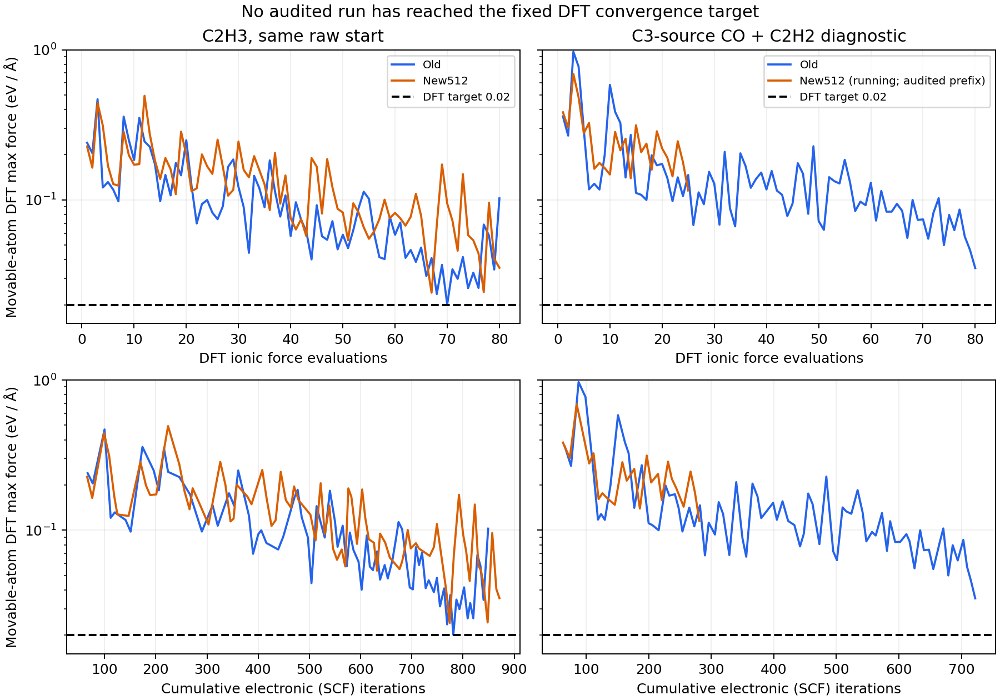

# Fe(110) 新旧模型：ML交接失配与剩余DFT成本

结论：**这轮尚未实现“ML预优化后，DFT几十步内达到0.02 eV/Å”的目标。** C₂旧/新模型均用尽80步且未达标，新模型没有减少电子迭代数。C₃旧模型同样80步未达标，新模型在本次回收快照中仍运行。较小的模型预测残余力或较低的第80步DFT力，均不能据此称为实际加速。

本次为已有四项任务的只读回收与比较，回收截至客户端北京时间2026-10-28 18:24。运行中任务只报告保守完整前缀，不代表最终状态。未续算、重试、提交计算或启动训练；未晋级模型、接纳训练标签或登记科学接受结果。

## 比较对象与口径

沿用冻结的同起点实验：10_A C₂H₃及CARE05 C₃来源，每个原始起点分别用旧模型和新512模型预优化。ML为LBFGS、最多80步、停止阈值0.10 eV/Å；后续VASP最多80步、32 MPI ranks、EDIFFG=-0.02、EDIFF=1e-5、同一生产设置。

- 旧模型SHA256：`cfcac123cd56b866a1ea36cc780a3aee634f3aeec979bda4ae8bee2cc831e523`。
- 新512模型SHA256：`513decf4ebd823cf8f87a79e787fdbd543b657fd582184f2ab23845d281d6aeb`。
- DFT前置范围与四个原始回执：[提交审核](../fe110_pair2_submission_20261027/README.md)。ML原始几何分类：[同起点审核](../fe110_pair2_20261027/README.md)。

每一行分别比较“该模型末帧”和“它交给VASP的第一帧”，两者坐标一致；旧/新模型各自的末帧不是同一构型，因而本表属于各自优化后的交接比较，不能替代固定结构上的模型误差基准。

## 1. ML末帧与VASP第一步的同坐标力

以下最大力均为**全部可动原子**的力模长最大值，单位eV/Å，固定底层18个Fe不计入。

| 体系 | 模型 | ML预优化步数 | ML预测最大力 | 同坐标DFT最大力 | DFT吸附物最大力 | DFT最大力原子（从0编号） |
|---|---|---:|---:|---:|---:|---|
| C₂H₃ | 旧 | 47 | 0.090451 | 0.239860 | 0.150539 | Fe38 |
| C₂H₃ | 新512 | 48 | 0.088025 | 0.226764 | 0.196921 | Fe43 |
| C₃来源：CO+C₂H₂ | 旧 | 68 | 0.070262 | 0.360368 | 0.251223 | Fe44 |
| C₃来源：CO+C₂H₂ | 新512 | 80，上限 | 0.228697 | 0.383352 | 0.234249 | Fe44 |

四项ML末帧与DFT输入坐标的最大差异≤2.56×10⁻¹⁵ Å；VASP第一步原始力表的坐标按打印精度逐原子核验，力表原始字节哈希和向量重放通过。四个第一步SCF均达标，局域Fe磁矩均为正。输入POSCAR、INCAR、KPOINTS与冻结提交哈希一致。

模型预测的残余力小，不等于其预测误差小。C₂新模型在交接点的全可动原子向量RMSE为0.075006（旧0.090752），但吸附物向量RMSE为0.086436（旧0.077515）。这些数值来自各模型不同末帧，不能解释为固定坐标上的优劣排序。四个交接点的最大DFT力均在可动Fe上，后续诊断应包含表面Fe。

ML停止阈值0.10本就比DFT验收阈值0.02宽松5倍。只把ML阈值调严，尚不能证明能消除同坐标DFT力失配。

## 2. 实际剩余DFT步数与成本

| 体系/模型 | 作业ID | 队列快照 | 已审核离子步 | 末帧DFT最大力 | SCF迭代总数 | VASP elapsed/h | 分配核时 | 正式达到0.02？ |
|---|---|---|---:|---:|---:|---:|---:|---|
| C₂/旧 | 9925060 | DONE | 80 | 0.102388 | 849 | 13.557 | 433.812 | 否 |
| C₂/新512 | 9925063 | DONE | 80 | 0.035274 | 871 | 18.056 | 577.779 | 否 |
| C₃来源/旧 | 9925062 | DONE | 80 | 0.035146 | 722 | 12.557 | 401.825 | 否 |
| C₃来源/新512 | 9925065 | RUN | 25个完整前缀步 | 0.115549 | 281（此前缀） | 未结束 | 未知 | 尚未证实 |

三个DONE任务均有正常结束页，但没有`reached required accuracy`，达到步数上限与离子收敛分开记录。全部265个已审核力帧均未≤0.02 eV/Å；不存在可被误当作收敛的短暂达标帧。≤30步和≤50步实际达标均未得到证明。

C₂新模型第80步残余力较低，但它用了同样80步、更多SCF迭代和更多实测分配核时，所以这次不能称为加速成功。核时按OUTCAR正常结束页elapsed×32/3600计算，包含该次VASP运行耗时；不包括排队、ML、标注和训练成本。不同节点负载等条件未完全控制，不能将墙钟差异全部归因于模型。没有同一原始起点直接DFT的无ML对照，不能报告相对纯DFT的加速倍数。

首次越过较宽阈值仅作诊断：

| 体系/模型 | 首次≤0.10：步/累计SCF | 首次≤0.05：步/累计SCF | 过程最低最大力 |
|---|---:|---:|---:|
| C₂/旧 | 7/151 | 32/504 | 0.020133 |
| C₂/新512 | 36/512 | 66/767 | 0.024086 |
| C₃来源/旧 | 17/216 | 74/679 | 0.035146 |
| C₃来源/新512 | 未达到 | 未达到 | 0.115549，25步前缀 |

本表不改变0.02验收标准，不把某个过程低点代替最终收敛。

[可导出的PDF](remaining_dft_work.pdf)。曲线来自原始OUTCAR所有已审核完整力帧；运行中曲线止于保守完整前缀。

## 3. 质控、隔离与尚未验证内容

- 用原有raw-frame解析器建立离子步、电子迭代、明确EDIFF标记、OSZICAR能量及局域磁矩的逐帧对应；265/265 SCF通过、265/265局域磁矩审核通过。Fe局域磁矩范围：C₂旧1.631–2.642、新1.625–2.643；C₃来源旧1.340–2.615、新1.379–2.613 μB。等级保持`LOCAL_MOMENTS_REVIEWED_POSITIVE_FE`，不证明磁性全局基态。
- 四份CONTCAR快照的晶胞、元素顺序和固定标记一致；固定层最大位移<8.8×10⁻¹⁴ Å，最短原子距≥1.095 Å。C₂保持C₂H₃连接，C₃保持输入的CO+C₂H₂片段。运行中CONTCAR单独审核，不断言它恰好对应保守OUTCAR前缀的最后一帧。
- C₃在ML阶段已失去原始C–C连接。本次DFT处理的是解离候选，不能证明完整C₃吸附优化有效，也不能证明该解离是真实稳定产物。
- 尚未验证：符合相同化学终态及磁性要求的DFT收敛终态、同一极小值、有效能量差、纯DFT加速倍数、推广到其他起点的成功率。
- 保持512/78/53数据隔离及原磁性等级；本次对照轨迹不自动加入训练或开发集，也不用于反复挑模型。没有修改被冻结的输入、标签包、模型或旧报告。

最合理下一步：**先在既有训练/开发数据上检查近稳定区的可动表层Fe和吸附物力误差，再确定针对性的训练调整方案。** 后续模型以同起点、固定DFT标准、几十步内真实收敛及实际成本验收；本次比较样本继续隔离。没有据此启动新的训练或计算。

## 可复核证据

本地证据根：`calculations/fe110_reico_pilot300_20261022/paired_cost_comparison_20261028_v5/`。原始大日志保留在服务器，回收保存源字节范围、全源快照SHA256、程序原文、首帧原始力表及小文件哈希。第1–4版超时/部分回收证据保留；仅重读缺失日志，没有重试计算。整数偏移使用`itertools.accumulate`替换NumPy累加，科学力/磁矩解析函数沿用已有owner。

- `analysis.json`：`20a1b961b3674e5a866846927f3007a33d1a3ef53dd521e6f77cc9287fce9e92`。
- `verification.json`：`ef8d822eb990781d0cb1682a93041eafe7214097e2834d0a5904c192f0360262`；40项独立标量检查通过，4份首帧原始向量重放通过。后续曲线依赖源绑定owner提取，未声称逐帧全向量独立重放。
- 语法检查、相关Ruff及47项直接相关测试通过；图件已目视检查。代码只在显式主入口读取服务器，没有提交/停止/续算命令。未执行全仓库测试。
- 仓库状态同步仍受既有`sbq_catalyst_agent_workflow.egg-info/PKG-INFO`分类后变更冲突阻塞，与本次科学比较无关。
