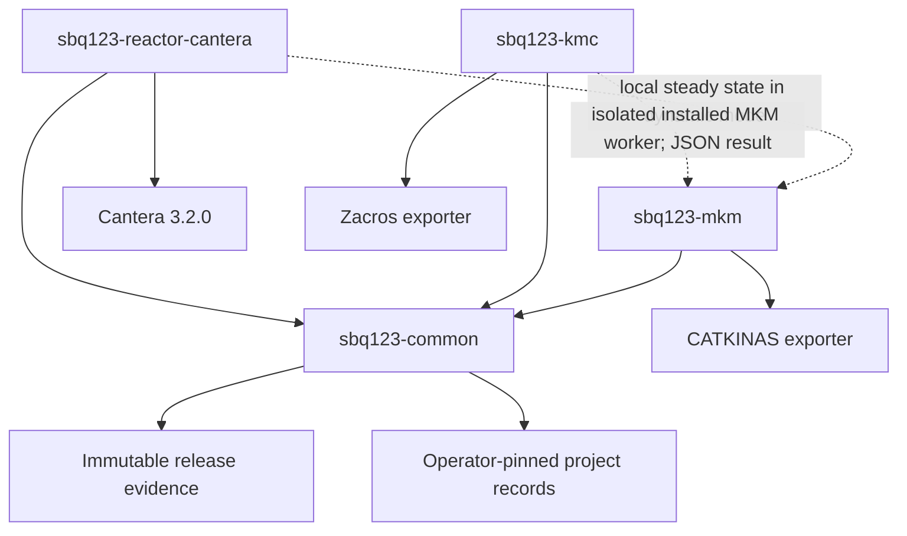
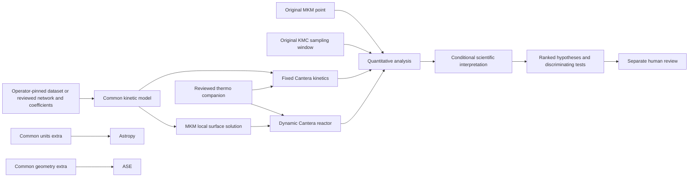

# SBQ123 V3.2 audit candidate

The development base is the v3.1.0 release at commit `1e899d0d91e0948ed3739b9d623dbbe9e31de637`, tree `88528eba2de8903ab161e64493abbb846cf94a41`. All V3.2 runtime changes belong under `src/sbq123`. The four distribution projects select disjoint portions of that namespace. Historical data, regression cases and V3.1 source remain at their released identities.

## Package and process boundaries

| Distribution | Owns | Runtime dependencies inside SBQ123 |
|---|---|---|
| sbq123-common | Evidence, scientific identities, material and rate contracts, shared historical code, scientific analysis, discovery, workflow and artifact utilities | — |
| sbq123-mkm | MKM variants, CATKINAS compatibility, point reader and local mean-field steady-state solver | common |
| sbq123-kmc | KMC variants, Zacros compatibility, sampling-window reader and cross-engine comparison coordinator | common |
| sbq123-reactor-cantera | Reactor conditions and reporting, fixed and local source evaluation, balances and solvers | common, with MKM optional for dynamic mode |



MKM and KMC run in separate Python environments. A reactor environment can add the MKM distribution to solve a surface system. Each simulation owns its continuation anchor and receipts. A fixed-kinetics installation operates independently of either engine package. The stochastic source protocol reserves a future sampling interface.

The KMC comparison process takes its worker interpreter from deployment setting `SBQ123_MKM_PYTHON`. The worker imports installed MKM code with `-I -B`. An adjacent data directory can supply separately hash-checked inputs. Its Python files stay outside the worker's search path. Successful comparisons record the historical input role versions separately from the installed worker identities.

## Scientific configuration

The common distribution contains versioned registries for engine families, archived replays, kinetic datasets, basis conversions, catalyst profiles, analysis profiles and DRC definitions. A release-owned trust index pins each registry's bytes. A second pin authenticates the validation schemas. Each registry also binds its entry contents canonically. Selectors received in requests resolve through the installed index. The result interpreter requires a digest retained by the producer.

Project selectors can resolve a reviewed kinetic model or a paired network and kinetic dataset, an independently reviewed thermochemical companion, and catalyst or conversion records. The operator provisions a detached digest of the project trust store. Release identifiers retain lookup priority. Requests cannot change the operator pin. The historic 400 K, 160000 Pa archive retains its source scope. [Project trust contract and runnable example](PROJECT_TRUST.md)

MKM analysis validates per-mass turnover and saved comparisons through the
[detached mass calibration contract](MKM_MASS_NORMALIZATION.md).

## Scientific entry points and dependency ownership



Both OS jobs verify the installed roles and run their historical scientific tests. The optional dynamic installation adds MKM to Cantera. Project evidence is selected in the requesting operation. An unavailable mass calibration leaves the native point and any independent kinetic or reactor analyses available.

## Reactor equations and output

The supported cases use ideal gas and fixed temperature. The inlet defines the reference pressure. The fixed PFR checks axial momentum flux and mass flux. The dynamic PFR specifies constant pressure. Energy transport, friction, mass-transfer resistance, uncertainty propagation and physical catalyst qualification are outside this dataset.

| Mode | Cantera engine | Independent balance |
|---|---|---|
| Fixed PFR | FlowReactor, ReactorNet and IDA, with ReactorSurface for registered surface chemistry | dFᵢ/dz = A rᵢ, dτ/dz = A/Q. Integrate the registered source separately along the physical mesh |
| Fixed CSTR | IdealGasReactor with a feed reservoir, mass-flow controller, pressure-controlled outlet and ReactorNet | Fᵢ,in − Fᵢ,out + V rᵢ,out = 0 for every species |
| Dynamic PFR | ExtensibleIdealGasConstPressureReactor with CVODES advances the mass fractions in distance | dFᵢ/dz = A rᵢ with the local MKM source. Residence time integrates the reciprocal local velocity |
| Dynamic CSTR | The extensible vessel uses the same continuous feed and withdrawal devices | A local MKM solves surface balance inside each RHS call. The final species and outlet mass balances must close |

The native gas and surface mechanism uses kg, m, kmol and s. The registry uses mol, m and s. The adapter converts activation energies, site density, molecular concentrations and elementary reaction orders, then compares forward and reverse progress rates at two independent mixture compositions. Its release-owned thermodynamics describe manufactured controls with a virtual element X. Density and specific area apply to the registered synthetic catalyst and its approved basis conversion. The archived V3.1 mechanism lacks the companion thermodynamics needed for this adapter.

For a native surface PFR in Cantera 3.2.0, the spatial residual uses the last gas species' wall mass flux in the continuity equation. At the supported local surface steady state the physical sum is zero. The adapter appends an empty inert gas coordinate as that last component, verifies its population and the summed wall flux at every mesh point, and projects the physical species into the report. This is specific to the pinned engine and to zero net wall mass transfer. The independent analytical profile checks the resulting solution. [Cantera 3.2.0 spatial residual](https://github.com/Cantera/cantera/blob/v3.2.0/src/zeroD/FlowReactor.cpp)

A separate Cantera interface represents each independent site family. The current reference inventory requires one of each family at the same site density. Cross-family elementary steps and adsorbates spanning families need a coupled interface description. A missing thermochemical companion limits Cantera execution only.

The local MKM validates a scaled surface residual, Jacobian rank, orientation, site inventory and displacement from an accepted coverage. PFR continuation follows a physical mesh independent of output sampling. The first solve can explore the admissible coverage interval. Subsequent accepted roots supply the continuation anchor. CSTR multistart accepts gas-flow vectors or joint gas-flow and surface-coverage seeds, retains rejected seeds and reports distinct converged roots. Local tests establish neither global uniqueness nor dynamical stability. The CSTR uses a unit-volume representative with identical flow per volume and physical source density, then restores the requested flow and volume for its independent balances.

For A → B with rate k cₐ, normalized PFR conversion is 1 − exp(−kτ), and CSTR conversion is kτ/(1+kτ). The Langmuir control has θ = a/(1+a). With inlet a=1 and unit turnover its PFR obeys ln(a)+a=1−τ and its CSTR satisfies a²+a−1=0. Other controls cover reversible exchange, a stiff two-timescale cascade and an autocatalytic CSTR with three roots.

Schema 2 binds input, mechanism, model and result digests. Each point records SI conditions, flow, residence time, inventory, mass and elemental residuals. Yield uses product formed per mole of reactant fed. Selectivity uses product formed per mole consumed. If consumption is numerically unresolved this ratio is null. Gross directional traffic, signed net progress and species balance remain separate outputs. Uncertainty is null. Interpretation requires an independently retained digest. The dynamic extra installs the MKM distribution; no native engine runs.

## Reproduction

Use CPython 3.13. Install setuptools 80.9.0, wheel 0.45.1 and the retained scientific dependency lock in the build/verification environment. From the candidate checkout run the following commands, selecting an external output directory. The four distribution names are unique. A repeated build with the same inputs verifies an existing identical wheel. Different bytes at an existing destination produce an error.

```text
python tools/v32/build.py EXTERNAL_WHEELS
python tools/v32/ci.py common NEW_EXTERNAL_COMMON_CHECK
python tools/v32/ci.py mkm NEW_EXTERNAL_MKM_CHECK
python tools/v32/ci.py kmc NEW_EXTERNAL_KMC_CHECK
python tools/v32/ci.py reactor NEW_EXTERNAL_REACTOR_CHECK
python tools/v32/ci.py reactor-dynamic NEW_EXTERNAL_DYNAMIC_CHECK
```

The default reproducible epoch is 1795600000. A supplied SOURCE_DATE_EPOCH overrides it. Wheel publication verifies backend RECORD digests and writes deterministic entry ordering, timestamps and permissions. Scientific resources retain their original bytes.

For a reactor calculation, install sbq123-reactor-cantera and its declared dependencies. Run `sbq123-reactor request.json`. An example fixed-mode request is below.

```json
{"kind":"PFR","dataset_id":"first-order","mode":"fixed","temperature_K":400,"pressure_Pa":3325.785047261296,"composition":{"A":1,"B":0},"volume_m3":1,"area_m2":1,"inlet_mol_s":1,"reactant":"A","product":"B"}
```

This analytical case has conversion 1 − exp(−0.75) at one second. The analytical-control designation travels with its result. No native executable or scheduler participates.


## Downstream scientific workflow

The installed common distribution owns offline scientific analysis and explanation. Each role replays its own point or sampling window. Optional Reactor reports supply axial or steady outlet data using the original registered denominators. Mechanism discovery consumes bound observations and perturbation results through the existing priority, human review and returned-result interfaces. See [scientific workflow entries and evidence boundaries](SCIENTIFIC_WORKFLOW.md).
