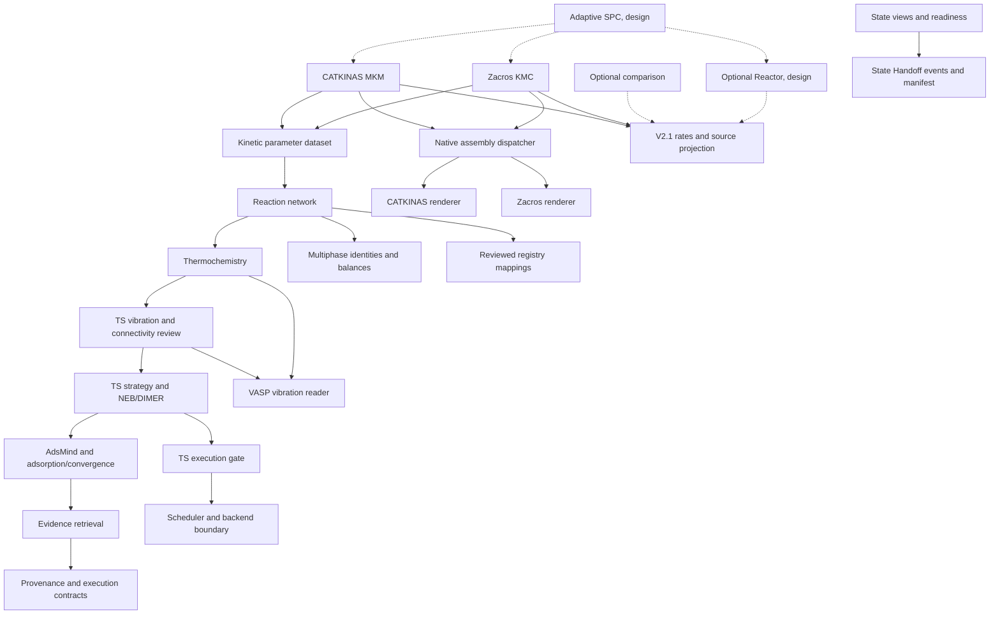

# Repository architecture and ownership

## Repository layers

| Layer | Implementation and role |
| --- | --- |
| Scientific contracts | `configs/catalysis/*.schema.json` and `configs/kinetics/*.schema.json` define interfaces. `scripts/multiphase_contracts.py`, `scientific_intake.py`, `kinetic_data/` and `rate_output_v2.py` implement cross-record semantics and shared math. |
| Scientific workflow | `modules/*/README.md` document authority and expected outputs. Most implementations are under `scripts/`. `configs/skill_routing.yaml` routes to module owners. |
| Native adapter and orchestration | Engine renderers and parse/qualification code are under `baseline_mkm/` and `surface_kmc/`. `native_inputs.py`, `native_model.py`, `native_validation.py` handle input helpers, dispatch/staging and offline readback. Atomistic orchestration has separate TS/VASP and GPU execution paths. |
| Persistence and integration | Registry transactions own SQLite writes, Excel promotion has its own reviewed projection, State Handoff owns repository lifecycle, and files/receipts bind external evidence. Evidence and immutable lineage remain in their owning stores. |
| Shared infrastructure | `artifact_io.py` (bytes, canonical JSON, exclusive writes), `jsonl_io.py`, `provenance_fields.py`, `scientific_validation.py`, `optional_dependencies.py`, `runtime_resources.py`, `execution_backends.py` and `execution_permission.py`. Packaging and CI use `pyproject.toml`, `configs/release_resources.json`, `release_*.py` and `.github/workflows/state-manager.yml`. |
| Evidence and reference | `docs/`, `tasks/`, `reports/`, `calculations/`, `data/`, `artifacts/`, `outputs/` and `archive/` have distinct lifecycle and publication roles. `skills/` supplies workflow routing and supporting tools. The audit inventoried code from the four specified roots and read selected historical evidence. |

The file inventory gives paths, source/archive/test classification, definitions, imports, reverse consumers and selected side-effect call sites. A row's public definitions are a syntactic index of top-level names without an underscore. The supported API is established by the owner documentation, calling code and tests.

## Logical dependencies

Arrows in this graph point from a consumer to its inputs or dependencies. Dotted edges represent a documented or conditional route.

Scientific and persisted evidence dependencies in this graph include handoffs that need no Python import. Registry reads are separate from reviewed writes. `scientific_priority` has a real dependency on MKM ticket intake. Its proposal and ranking path supports bounded research next actions and does not stand in for the documented adaptive dispatch.

## Major module responsibility and authority

| Owner and supported entry points | Internal dependencies and consumers | Input → output, persistence and execution boundary | Maturity evidence |
| --- | --- | --- | --- |
| Evidence retrieval, `catalysis-search`, `catalysis-validate` | `catalysis_retrieval/{workflow,records,ranking}` consumes source access settings. AdsMind, adsorption and TS consume reviewed retrieval | Exact species/surface/evidence query → provenance-bound source result and reviewed motif. Evidence only, no admission of external energies to local kinetics | Retrieval/validation and cache tests support bounded implementation. Source access and any motif need their own evidence |
| AdsMind, `plan_adsorption_candidates`, `detect_surface_sites`, `generate_adsorption_candidates`, `validate_candidates` | `adsmind_lite/`, `configs/adsmind_lite/`. Retrieval, geometry and reviewed templates feed adsorption | Surface, explicit sites or supported detector, motif, species → candidates/review JSON and geometry. GPU candidate handoff is project-gated | Fe metallic detectors and manifest paths tested. Real metal–oxide and carbide generalization remains unverified |
| Adsorption and Fe convergence, `scripts.adsorption.*`, `scripts.convergence.thickness_stage`, `modules/fe_convergence_baseline/validate_baseline.py` | VASP input/result policy, AdsMind, canonical submitter and registry. TS and kinetic intake consume reviewed structures/energies | Reviewed starting structures and compatibility → job receipts/relaxation evidence/baselines and staged registry data. Remote runs use the owning gate and approved host | Scoped Fe validations and guarded submission tests. Fe convergence settings remain project-specific |
| INCAR custodian and VASP evidence | `modules/incar_custodian/README.md` delegates command implementation to the installed Fe INCAR skill. Project profiles in `configs/incar_custodian/` map workflow stages to the existing Fe(110) settings. VASP evidence helpers in `vasp_inputs.py`, `vasp_result_gate.py`, `vasp_lsf.py` and `neb_agent/` serve convergence, adsorption and TS | Calculation artifacts → physical/parameter diagnostics, suggested INCAR or input settings. Recommendations cannot launch work or validate geometry | Parser/CLI and policy regressions distinguish executable diagnostics from scientific acceptance |
| TS endpoint and structure-purpose layer, `scripts.ts_endpoint` | `validator`, `generator`, `database`, `evidence`, `purpose` consume explicit endpoint/atom context. Historical `modules.ts_endpoint_*` paths are source aliases | Endpoint candidates → mapped identities, trial structures and evidence records for TS. No independent job authority | Compatibility alias, mapping and endpoint contracts tested |
| TS strategy, `ts-strategy` / `scripts.ts_strategy_engine.cli` | `execution_gate`, `execution_evidence`, `handoff`, validation and learning packages, `scripts.neb_agent` numerical path/submission use workflow geometry and scheduler evidence | Bound endpoints and mapped reaction → plan/path/review/decision, gated NEB/CI-NEB/DIMER actions and immutable receipts. Scientific claims checked separately | Extensive boundary tests and scoped Fe evidence. Current scientific progress is source/evidence-specific |
| ML and scientific candidate campaigns, `aqcat25_*`, `matris_*`, `dual_model_*`, `prepare_*` | Root CLI/campaign scripts plus TS learning and `ml_candidate_source` use backend config, model/artifact hashes and explicit workdir | Structures/checkpoints → candidate paths/forces/training/inference packages. GPU output may inform review. GPU allocation and any labels/submission require existing authority | Mixed reusable helpers and campaign-specific entry points. Code and historical pilot evidence vary by campaign |
| TS vibration validation, TS CLI VFA/connectivity | `vasp_vibrations.parse_frequency_outcar` owns raw observations. `ts_validation/{analyze_vfa,connectivity}` and `scientific_claims` qualify | VASP OUTCAR/POSCAR, atom scope and approved saddle → modes, connectivity, grades and bounded claims. File receipts and Registry carry accepted results. TS engine owns any frequency execution | A.2.5 raw reader consolidation and compatibility tests. Raw observations and an accepted local mode prove different claims |
| Thermochemistry, `python -m scripts.thermochemistry` | `thermochemistry/{frequencies,harmonic,engine}`, `scientific_intake`, and TS review. Downstream consumers are the network and rate laws | Reviewed IS/TS/FS and basis/conditions → eV corrections with provenance and limitations. Derived files only under this module | Analytical/unit tests plus scoped Fe local corrections. Network and rate work requires compatible states before free-energy/rate work |
| Multiphase structural/kinetic data, `python -m scripts.multiphase_contracts`, `scripts.rate_output_v2` | Schema resource loader, shared validation, `kinetic_data/{interphase_transfer,stoichiometric_sources,native_rate_output}` | Versioned definitions or native-basis results → cross-record/shape/sum checks and source rows. Adapters write requested JSON under the file-only output contract | Stage B.1 and B.2 offline contracts and archived replay. Network-bound validation gap R1-001 |
| Reaction network, `python -m scripts.reaction_network` | `catalog`, `builder`, `cross_phase`, `site_review`, `thermodynamics` use intake and reviewed Registry mappings. Kinetic generation consumes signed network | Bundle, site/TS review and thermochemistry → versioned network, direction, gaps and qualification. No launch by building a network | Scoped Fe and synthetic networks. Generic offline cross-phase representation and blocked evidence paths tested |
| Kinetic parameters, `python -m scripts.kinetic_parameters` | `engine.generate`, `laws`, `export.{catkinas,zacros}`, rate-unit and normalization helpers. Network and conditions feed both engines | Versioned network and law/condition evidence → fixed-condition dataset, parameter sets and per-engine export. Native exports do not grant run approval | Independent law/unit evidence and distinct native export qualification. Bridge and complex topology need separate evidence |
| CATKINAS MKM, `baseline_mkm.{network_mapping,single_point,analysis,drc_pair,drc_batch,sensitivity_study,reaction_order,rate_adapter}` | Native input exports, MATLAB reader, MKM result reconstruction, shared source calculator, H7 ticket binding and Registry validators | Scoped definition/dataset/config → byte-bound inputs → separately approved process → MAT/log/echo, qualification and derived analyses. Registration emits a batch for reviewed Registry application | Closed-cycle and single point, bounded DRC/composition evidence, and archive replay. Oxide multi-inventory capacity unresolved |
| Coverage and sensitivity | `baseline_mkm/{molecular_coverage,kinetic_analysis}`, DRC and sensitivity modules. `scientific_priority` ranks evidence proposals | Footprints and observed amounts/capacity → site ledger. Accepted MKM runs with reviewed perturbations → sensitivity, DRC and order metrics. Each native job stays under MKM gate | Generic count accounting and specific bounded native evidence. `modules/coverage_mkm` still requires a coverage-dependent interaction/model workflow |
| Zacros KMC, `native_model … zacros`, `surface_kmc.rate_adapter`, `surface_kmc.zero_event_review` | `lattice`, `native`, `trajectory_statistics`, checkpoint handling, native readback and approved control review | Typed physical lattice, local events, directed rates and seeds → native members. Archive receipts and checkpoint → native-cell rates. Offline preparation grants no execution. Zero-event path checks exact review and has no Python launcher here | Ni/Cu seeded/dentation/restart native evidence. Oxide fixture structural only, current native attempt failed at temperature token |
| Reactor, `modules/reactor_simulation/README.md` | Optional qualified kinetic source terms, physical basis mapping and reactor assumptions | Source/evidence + operating domain and load → intended isothermal CSTR/PFR balances. No repository solver, schedule or persistence flow located | ADR and intended contract only |
| Registry and Excel, `registry-init`, `registry-write`, `registry-promote` | `registry_schema`, `registry_mutations`, `registry_acceptance`, `registry_compatibility`, transaction/connect helpers and Node writer | Approved plan/compatible evidence → transactional SQLite writes. Separate approved projection → Excel view and receipt. Scientific acceptance stays with owning scientific module | Architecture and SQLite tests on temp stores. Production schema/deployment untouched |
| Execution substrate, VASP submitter, backend loaders and gate checks | `execution_backends`, `execution_permission`, `scheduler_evidence`, `neb_agent.submission`. Selectors call gates rather than edit queue state | Role/host, path, hashes, action and authorization → local or remote execution/receipt. Scheduler state is its own evidence | Boundary tests guard command ownership and evidence. CATKINAS portable lifecycle mismatch in R1-010 |
| State Handoff / governance, `repo-state`, `capability-readiness`, `document-governance` | `state_manager/{store,proposals,projections,audit}`, manifest/config, immutable lifecycle/history. Git and memory docs cover continuity | Active events plus review and hashes → managed Markdown and projection manifest, separate from scientific results. `sync` flag mismatch in R1-003 | Core transaction/projection/review tests. Observed drift and backlog in this branch |
| Packaging and tests | `pyproject.toml`, explicit resource manifest and release build. `tests/` consumes public and some internals | Packaged `scripts` plus enumerated portable resources, CI artifacts and local temporary fixtures. Test-only native execution capability requires extra guards | Linux full validation configured, Windows/Linux engineering and wheel subsets configured. R.1 executed focused Windows tests |

## Measured code quality

- The inventory records **309** Python files under `scripts/`, **74** under `modules/` (68 archive, 5 compatibility aliases and 1 Fe baseline validator), **139** under `tests/`, and **0** under `configs/`. Baseline total is 103,154 physical lines, including archived code and tests. Non-archive implementation has 60,068 lines and 1,134 resolved directed file-import edges. The scan detected no nontrivial strongly connected component in that implementation graph.
- Runtime coupling survives the acyclic source graph. Both engines import shared assembly, which loads both native implementations. The parameter engine uses private structural validator functions. The test bootstrap prepends five extra import locations, and the scanner records unresolved local/bare imports as external-root candidates. Wheel CI separately covers a limited installed entry-point surface. See R1-004, R1-006 and R1-014.
- Size is an inspection prior. `dual_model_ml_neb.py` (1,993 lines, longest function 185), `mlip_same_structure_benchmark.py` (1,295 lines, longest function `assess_benchmark`, 333 at line 911), `state_manager/projections.py` (972) and `ts_validation/analyze_vfa.py` (816 lines, `analyze_vfa` 290 at line 286) deserve different treatment. NEB has numerical kernels and runtime translation. Benchmark assessment mixes several kinds of evidence. Projection code multiplexes independent view types behind shared transaction semantics. VFA already owns a meaningful single scientific outcome, with smaller testable sections available when a behavior change requires them. No line-count threshold justifies a rewrite.
- Existing narrow protections include strict duplicate-key reads, temporary or exclusive artifact staging, raw-byte versus canonical-object hashes, permission checks at launch sites, and optional dependencies loaded at use. There is no configured static typing gate. Scientific dictionaries and related validators carry the semantic burden. Observable statuses, explicit subprocess bounds and cleanup are more valuable here than dataclass conversions or wholesale annotation.
- `modules.ts_endpoint_*` and `modules.structure_purpose_manager` have no detected production import consumers in the four audited roots and do have explicit compatibility tests. `native_model` re-exports `token`, `integer`, `conditions` deliberately after A.2.2. Existing external callers are unknown. The scan found no identical normalized AST body of at least eight source lines across two `scripts/` files. It cannot rule out semantic duplication or unobserved external use. [Inventory](python-inventory.csv) · [Duplicate inventory and boundaries](scientific-data.md)
