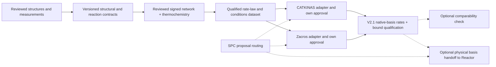

# Target architecture and catalyst portability

## Preserve existing owners and make dependencies explicit

- Keep catalyst identity, footprint, reaction balance, version/digests and dimensional rates in the existing shared contracts. Use keys and generic validation for new compositions, phases and site identities. Keep numerical roles of local site capacity, coverage fractions, lattice degree, event multiplicity and macroscopic density explicit.
- The native adapter owns law representation, aliases, native type syntax, import/export, optional dependencies, exact plan/receipt and engine-specific result qualification. Reuse the existing hash/permission primitives for execution. A common CLI may select one engine and delegate. Neither adapter should import the other's implementation or wait for its result.
- Keep V2.0 compatibility and V2.1 as the rate exchange. Use a stricter network-bound input check and explicit consumer qualification before reuse, as described in the debt register. Store immutable raw evidence and qualification in existing stores, with content links. Engine-specific uncertainties and sample windows can remain in bound result sidecars.
- SPC uses the question, evidence, applicability, constraints and cost to propose one or both engines. An owner qualifies and authorizes each proposed run. Continuing from one result is a scientific decision. Compare only commensurable evidence. Two engines that answer different objectives can deliver independently.
- Reactor consumes qualified species source terms or their validated rate model on a physical balance basis, with required state dependence, operating domain, initial/boundary conditions, catalyst loading and transport/enthalpy assumptions. An intrinsic rate at one temperature/pressure is not by itself a reactor-scale profile. Keep Reactor optional and reusable across sources.
- Preserve seven-node test inputs and historical evidence with their own scope, status and permissions. Use existing test/orchestration boundaries and existing Registry/State Handoff authorities. No additional registry or parallel state store is required.

## Three extensibility walkthroughs

These are contract-based desk checks. No pathway, structure, parameter or simulation for these hypothetical systems was selected or qualified.

| System | Data-only requirements and existing route | Conditional code changes and currently unsupported claims | Evidence before science |
| --- | --- | --- | --- |
| Fe5C2 (iron carbide) | Declare material/phase and the reviewed carbide crystal, facet/termination, exposed site IDs and aliases, bulk/adsorbate C roles, structure and energy reference. Supply a site manifest and local geometry/motif evidence through retrieval + AdsMind. Follow adsorption, TS/vibration, thermochemistry, signed network and law generation as needed. Use a periodic KMC cell only if its vectors, site types and events are declared. | `configs/adsmind_lite/site_rules.yaml` marks iron carbide sites manifest-only. Generic material/reaction paths need no Fe5C2 branch for supplied, supported data. A new detector or unfamiliar CATKINAS topology/Zacros event mapping requires its own implementation and evidence. The Fe(110) label, model and convergence settings do not establish equivalent carbide applicability. | Compare reviewed phase/termination/slab and compatible DFT references and distinguish lattice C from adsorbate under atom mapping. Bind physically supported inventories, relevant thermochemical states and rates. Verify native mapping and deployment with actual scoped evidence. |
| Ni/CeO2 metal–oxide interface | Two reviewed phases, their surfaces/termination and exact contact with site ownership, finite or periodic interface description, explicitly located species footprints, and approved defect/charge/oxygen reference scope if applicable. Use B.2.2.x structural and reaction validation, site mapping, thermochemistry and rate laws. Native mappings consume separate engine-specific evidence. | No core catalyst-specific branch for identities or balanced transfers. Automatic AdsMind detection is limited to supported families, and a reviewed manifest must satisfy the actual generator/rule set. A general interface lattice may need a qualified physical graph importer/adapter if it exceeds the current periodic renderer. No implication that Ni/Cu verified transfer or finite CO2 fixture establishes diffusion, spillover or CeO2 vacancy chemistry. | Verify local bonding, terminations, atom counts, surface/contact ownership, mapped TS and compatible energy/charge references. KMC needs contact graph and distinct event/neighbor multiplicity. MKM needs native activities, occupancy closure and a documented denominator for any bridge. |
| Pt/TiO2 with multidentate adsorption | Provide characterized material/phase/surface/contact, one molecular identity per state, explicit footprint multiplicity, participating phase/site IDs, separate capacities and count reference. Use structural+network validation, generic coverage ledger, thermochemistry and candidate local events. KMC needs dentation order, occupied-node map and compatible seed/cluster/event definitions. | `molecular_coverage.py` can derive per-inventory counts from explicit observations. Current CATKINAS adapter rejects multidentate native mapping. Native Q normalization across unequal inventories requires evidence and a scoped adapter change if supported. Zacros has bounded bidentate Ni/Cu evidence. An arbitrary Pt/oxide graph, footprint or event requires a separate native qualification, and may need finite graph emission if it exceeds current generic periodic paths. | Independently verify geometry/selective dynamics, per-leg support, graph degeneracy and capacity, reaction stoichiometry, and conservation for each inventory. Parameterize only from compatible qualified data. Cross-engine or Reactor handoff additionally binds normalization and relevant operating domain. |

The generic definitions are already broader than the current verified native capabilities. The portability work belongs where an actual data or engine contract is unsupported. Add an explicit reviewed manifest, scoped adapter capability or detector only when the existing path cannot express the needed evidence. [Current engine capabilities](engines-and-stages.md) · [Repair sequence](technical-debt.md)
