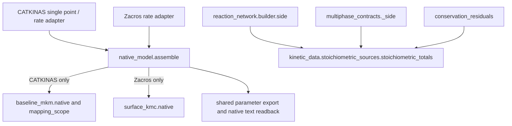

# R.2.4 completion — engine imports and conservation arithmetic

R1-004 and R1-005 were repaired in four production files. Each native assembly imports its selected engine package. Strict bundle validation, draft network assembly and signed conservation diagnostics now call the same pure function for weighted element, charge and site totals.

## Baseline and isolation

The remote repair head was `0a02c230207ff66352867091fe66b1f072ff536c`. Git ancestry checks included the production head `dd3a5cbbd180c97fe09a0554a6ef2a845ef95f73`, R.2.1 `5fb520a6`, R.2.2 `0e36efa0` and R.2.3 implementation `3b9360b9`. The implementation commit `c4095a636df2ae31b46cc690e190d589bc6ab617` has the specified repair baseline as its sole parent. Development and publication used distinct worktrees. The desktop tree at `233d5a6c` initially had 242 modified tracked files, three deletions and 1,100 untracked status entries. No repair files were staged there.

## R1-004 — observed imports

`scripts.native_model.assemble` previously imported both renderers and the CATKINAS mapping module before looking up the selected engine. The repair selects the engine once, then imports its renderer and readback and applies its preparation rules. Both branches reuse the supplied-table hash check. Manifest construction and the input publisher still have one implementation. Shared parameter exports and readback functions retain their existing public modules. The CLI still accepts one engine per invocation and returns that engine's original files and manifest. Existing dual-engine callers request both explicitly at the same public API, in either order.

| Selection in a fresh interpreter | Baseline renderer imports | Repaired renderer imports |
| --- | --- | --- |
| CATKINAS (MKM) | MKM and KMC | MKM and its mapping check |
| Zacros (KMC) | MKM and KMC, including the MKM mapping check | KMC |
| CATKINAS then Zacros | Both at first call | MKM at first call, both after second |
| Zacros then CATKINAS | Both at first call | KMC at first call, both after second |

Each isolated test blocks the unselected package and every submodule through Python's import machinery. The shared assembly and V2 reader import with both packages blocked. For each selection the test assembles the archived Phase 2.5 interface data, verifies manifest equality and exact native file bytes, and imports the selected rate adapter. The two single-engine probes independently reproduced opposite-package import failures at baseline. All four repaired selections passed.

## R1-005 — ownership and physical semantics

For molecular coefficients `n`, composition `a`, charge `q`, site footprint `f` and explicit vacancies `v`, the shared arithmetic is `Σ n·a`, `Σ n·q` and `v + Σ n·f`, with a separate entry for every element and site ID. The new `stoichiometric_totals` is extracted into the existing engine-independent `scripts.kinetic_data.stoichiometric_sources` module. None of the former three complete functions could be used unchanged by the other two because their validation and outputs differ.

| Caller | Previous calculation | Shared arithmetic after repair | Policy retained at caller |
| --- | --- | --- | --- |
| Strict exchange bundle, `multiphase_contracts._side` | Weighted positive side counts plus free sites | Gross side totals | Schema, species lookup, context, eligible-species review, complete metadata, left/right equality, required-site bounds |
| Draft network, `reaction_network.builder.side` | Same sums with independent missingness flags | Gross side totals; a missing component propagates only in its own dimension | Positive integer coefficients, known species, scope, draft gaps, missing composition allowed for cross-phase elementary reactions, conflicts and TS checks |
| Diagnostics, `stoichiometric_sources.conservation_residuals` | Weights against sparse signed columns, plus signed vacancy column | Same sums with products-minus-reactants coefficients and released-minus-consumed vacancies | Validates/canonicalizes noncancelling species metadata, preserves negative residuals, reports sorted global axes including known zero entries |

Molecular counts and site occupancies use different units. A molecule with two binding legs contributes one molecular coefficient and two site contributions. The B.1 source projector still computes molecular and vacancy rates separately from signed net progress. Missing net progress propagates through nonzero stoichiometric entries; an exactly cancelling participant can still have a known zero source. Gross transfer constraints, cross-phase scope, measured populations, covariance, rate units and native denominators remain with their owners.

### Dependency graph

Solid arrows below represent source dependencies. The two renderer edges are conditional at runtime. The maintained-source AST graph test includes imports inside functions and found no cycle.

## Scientific regression against existing evidence

| Evidence | Reproduced result |
| --- | --- |
| B.1 three-phase example | For net progress `[2,-1,0,3]`, molecular sources are `[-2,6,-1,-3,3]` and vacancy sources `[-5,1,-3]`. Making the third flux unknown gives `[null,6,null,-3,3]` and `[null,null,-3]`. Element, charge and site residuals are zero. |
| Ni/Cu counting reference | Molecular amounts are 0.30 bridge and 0.50 top. Capacity/occupied/vacant counts are (2, 0.80, 1.20) on top-Ni and (1, 0.30, 0.70) on bridge-Cu. |
| Synthetic oxide | Two bound CO₂ molecules occupy two acid and two oxygen sites. The two inventories separately give (4, 2, 2) and (3, 2, 1). |
| Interphase transfer | For unit progress: species changes −1/+1, vacancy changes +1/−1 on pools a/b. Ar, charge and both inventory residuals are zero. The scaled bidentate case moves two molecules with occupied-site changes −4/+2. |
| Cross-phase elementary reactions | The interface example gives molecular changes −2 H residents, −1 O resident and +1 contact product. A and B vacancies change +1/−1. The two- and three-phase fixtures have zero elemental, charge and per-inventory residuals. |
| Fe(110) qualification | Archived CH + CO remains DRAFT, with unknown direction and site balance, unavailable Gibbs energies and two blocked engine exports. Electronic forward/reverse/reaction energies reproduce 0.97360174 / 0.31429371 / 0.65930803 eV at the historical precision. |
| Native output bases | Both CATKINAS outputs retain the reference-site-pair denominator. All eight Zacros outputs retain the simulation-cell denominator. The archived MAT and event-counter/lattice oracles also pass. |

Comparisons at baseline and after repair reproduced the complete archived Ni/Cu and oxide validation objects through the public, source-bound analysis entry. For a normalized value comparison, sorted compact UTF-8 JSON (ASCII escaping enabled) hashes to `ed23a370a57479ff430fab361d888cbb61bf7ebc499aa32b3eea9ad575fbbf2f` and `01f2eb1bf27a9c593af24d86725c0ae60d2ee52f26d3205257a17c5b73580ffa`, respectively. A preliminary diagnostic had compared a lower-level coverage return to the complete archived envelope. The public entry supplies the missing status and source hashes and matches the full record.

The following hashes are SHA-256 of the exact replay bytes checked against the archive, including the separate qualification records.

| Engine | Archive / record | SHA-256 |
| --- | --- | --- |
| catkinas | phase2_5_2 | `e1a71272fc19b0f8756e4fcb64ad7ef2e3b83eac9572290b27cef1005bc17e77` |
| catkinas | phase3_0 | `eb73c3b756ad88316b792df4919c0e08cbe9e0967bcd4d6e2277a5eefcac2ec6` |
| catkinas | qualification | `9b8bb716277180587c32eb5cd0f4b90c3dfc32ce638a458d4a1717db18bac65d` |
| zacros | mono | `5d96357c05c3f5782f23818f0071330dd199b09e82e79b82f5d05eedf7d99367` |
| zacros | dent | `4fbd954adbfe88a1d65a8d40719ab56aca19db088029089b21f96e2720e1ecbf` |
| zacros | full | `dafa3b41d823c144b30be119690be1f1df50b9518958f5686e0f45c774ece404` |
| zacros | interacting | `73e1524fa096e0ffc6cef24c3e2638bdc497a195975e2b8dff67453be1fe075b` |
| zacros | attractive | `5e3d6a6708edb73208fe59cc3797b1d4bfbae6a044bbc8b4ae3ba0b0a9d08d44` |
| zacros | continuous | `f24c5f8b7def7aa89a95ccd0efd36f312084b1da09c5060d94e35df31aeaf330` |
| zacros | split | `f0c85072c95cc5c6a6de46fbe93411001fc271b30bd6c89b91193e7785e68f82` |
| zacros | resume | `c210a6448ae8fac95aa29d00717e2f40824e76daf539ed12f378fd4331cd6981` |
| zacros | qualification | `fa1577a131e850937cf5822cf8c2fc3f40bd5909c21ddb317cf990b4b20c70f5` |

## Test and publication verification

Before the repair the focused baseline passed 928 tests and skipped the single live CATKINAS test. The new import-blocking probes exposed R1-004 separately. Final Windows development and publication runs each passed **935 tests with one expected skip** (90.56 s and 85.78 s respectively). Both trees passed py_compile and Ruff on all six changed Python files. The final suite includes the R.2.1 509-test contract/adapter selection, the R.2.2 185 State Manager/Registry cases and the R.2.3 serialization, native authorization and archive tests. These groups are included in the total.

For reproduction, use `python -m pytest -o addopts= -q -rs` with the following test modules under `tests/` (prefix `test_`, suffix `.py`).

- State and Registry: `state_manager`, `b4_state_governance`, `state_log_projection`, `state_sync_repository_items`, `state_sync_task_ownership`, `state_sync_safe_only`, `registry_schema`, `registry_write`, `registry_excel_promotion`, `b4_registry_governance`.
- Contracts and sources: `rate_network_binding`, `rate_output_v2`, `rate_dimensions`, `native_rate_adapters`, `b1_contract_acceptance`, `b1_native_acceptance`, `kinetic_parameters`, `reaction_network`, `stoichiometric_sources`, `multiphase_contracts`, `interphase_transfer`, `cross_phase_elementary`.
- Native boundaries: `zacros_zero_event_control`, `zacros_zero_event_native_receipt`, `native_advanced`, `mkm_single_point`, `native_model`, `zacros_bridge_input`, `catkinas_closed_cycle`.
- Additional scientific and import checks: `inventory_accounting`, `multidentate_coverage`, `catkinas_oxide_multidentate_audit`, `oxide_bridge_topology`, `native_imports`. Also select `test_b5_architecture_boundaries.py::test_native_input_dependencies_stay_below_assembly` and `test_b5_architecture_boundaries.py::test_maintained_runtime_import_graph_is_acyclic`.

The full repository suite and Linux were outside this run. No scientific engine ran or production database was written. Historical `reports/multiphase` retains its baseline Git tree ID `150e0850364fda4307b0cda10966f070c1c3eba5`. The repository's pre-existing historical-compaction source mismatch still causes safe-only preview to exit 2; the start audit independently reports existing module-map drift. Neither is a new regression in these repairs.

## Exact changed files

- `modules/state_handoff/events/history-stage-r2-4-engine-conservation-20261122.json`
- `reports/architecture_repair/stage_r2_4/completion.md`
- `scripts/kinetic_data/stoichiometric_sources.py`
- `scripts/multiphase_contracts.py`
- `scripts/native_model.py`
- `scripts/reaction_network/builder.py`
- `tests/test_native_imports.py`
- `tests/test_stoichiometric_sources.py`

The new history event binds this report to a pending State Handoff proposal. Its review covers the historical summary and projection manifest only.
