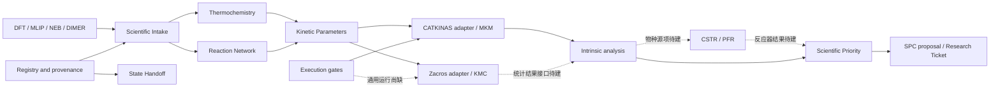

# 依赖图与扫描边界

[机器可读图](dependency_graph.json)逐节点给出开发目录源码 SHA-256 和直接导入邻接表。发布图以开发图为底，覆盖差异键，值为 null 表示删除该节点。两个图各自保存提交、节点数、边数、强连通分量和实际导入探针。

| 源树 | 模块 | 有向边 | 非平凡强连通分量 | 独立 Python 进程导入 |
|---|---:|---:|---:|---|
| 开发目录 | 328 | 1150 | 4 | 每组正、逆两个顺序，共 8/8 成功 |
| 独立发布树 | 287 | 1046 | 4 | 同法 8/8 成功 |

复算口径采用 tests/test_b5_architecture_boundaries.py 的 maintained_trees 和 imported_modules，保留范围内的本地 Python 导入，包括函数内延迟导入。节点沿用测试的文件名映射。动态插件、跨进程调用、外部 SPC 和原生二进制的依赖须由接口和回执补充。下图表达数据依赖；精确 import 边见 JSON。

科学证据沿箭头交接，执行还需要动作和输入的独立绑定。关联问题单、投影状态或图上可达不足以授予执行资格。
